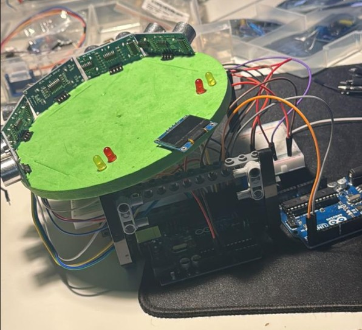
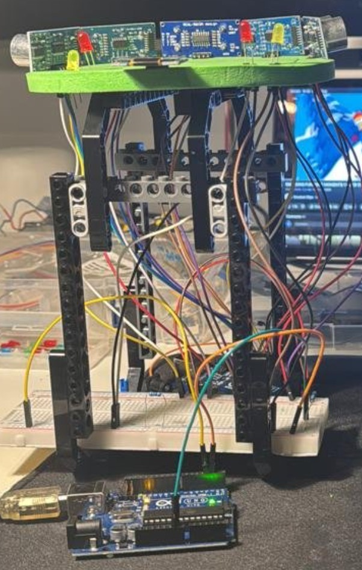
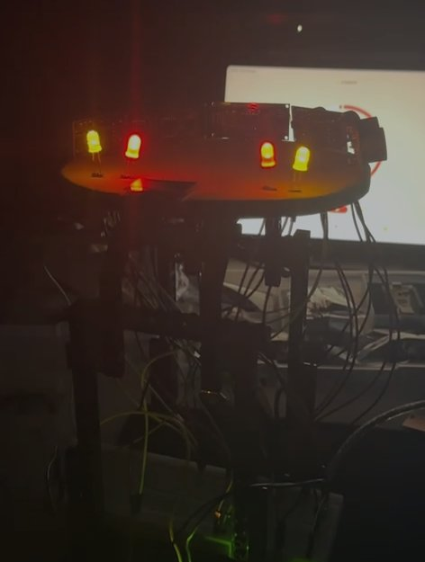

# Dual-Node AEB Trigger

Two Arduino Unos (C++, PlatformIO). A sensor node reads five HC-SR04 ultrasonic
sensors and sends the distances over UART. A relay node decodes them, works out
time-to-collision and drives hazard and brake outputs.

<p align="center">
  
  
  
</p>

## Structure

- `src/common/` - UART protocol, compiled into both nodes so the frame format exists once
- `src/sensor_node/` - reads sensors, sends frames
- `src/relay_node/` - parses frames, TTC logic, outputs

Two nodes because `pulseIn()` blocks. Keeping the decision logic on its own board
means it isn't stuck behind a sensor sweep.

## Protocol

8-byte frame over SoftwareSerial at 9600 baud. One frame is sent at the end of each
sweep, and another immediately whenever a sensor reads under 100 cm:

| Byte | Field | Value |
|------|-------|-------|
| 0 | Start | `0xAA` |
| 1 | Length | `5` |
| 2-6 | Payload | distance per sensor in cm, `255` = no echo |
| 7 | Checksum | XOR of payload |

The receiver is a byte-at-a-time state machine. It ignores stray bytes, resyncs on a
bad length, and resets after every frame whether the checksum passed or not.

## Time-to-collision

Closing speed comes from the nearest sensor's change in distance between frames.
`TTC = distance / closing speed`. Below 1.0 s the hazards switch on, below 0.5 s the
brake output switches on. A `255` reading clears the history, so a missing reading is
never treated as a close one.

Thresholds are based on UK Highway Code: 0.67 s reaction time and about
6.6 m/s² deceleration, both taken from the stopping distance table. The 0.67 s human
reaction is replaced with the estimated system latency below.

## Latency (estimated)

Sensors fire in the order 1,3,5,2,4 so consecutive sensors are never neighbours, with
at least 12 ms per sensor slot. A timeout slot lasts 30 ms.

Worst case is one close object among four timeouts, appearing just after its sensor
was read, so it is only seen on the next sweep:

| Stage | Object under 100 cm | Object over 100 cm |
|-------|---------------------|--------------------|
| Wait for sensor's next turn | ~150 ms | - |
| Wait for sweep to finish | - | ~240 ms |
| Frame transmit (8 bytes at 9600 baud) | ~8 ms | ~8 ms |
| Actuator (assumed) | ~100 ms | ~100 ms |
| Total | ~250 ms | ~350 ms |

Early send only applies under 100 cm. At 5 m/s the car needs about 3.6 m to stop, so an
obstacle is first seen well beyond 100 cm and waits for the sweep to finish. The speed
limit uses the 350 ms figure. Stopping distance is `v x 0.35 + v^2 / 13.2`, and with a
sensor range of about 3.5 m that gives a maximum speed of about 4.9 m/s (11 mph).

## Build

```bash
pio run -e sensor_node --target upload
pio run -e relay_node  --target upload
```

Wiring: sensor trig/echo on pins 2/3, 4/5, 6/7, 8/9, 10/11. Node link on pins 12 (RX)
and 13 (TX), cross-connected. Relay outputs: pin 2 hazards, pin 3 brake.

## Limitations

- `pulseIn()` blocks, so the sweep is slow. Interrupt-based echo capture would fix it.
- Only relative speed is measured, so a close gap at constant speed isn't flagged.
- Latency is calculated, not measured on hardware.
- Early sends make frames arrive at uneven intervals, so the closing speed between
  frames can be wrong. Tracking each sensor separately would fix it.